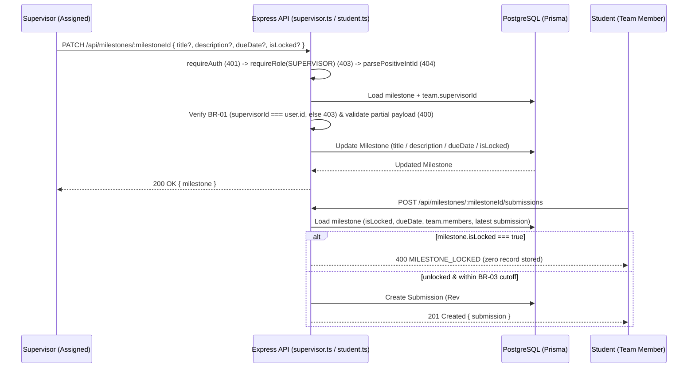
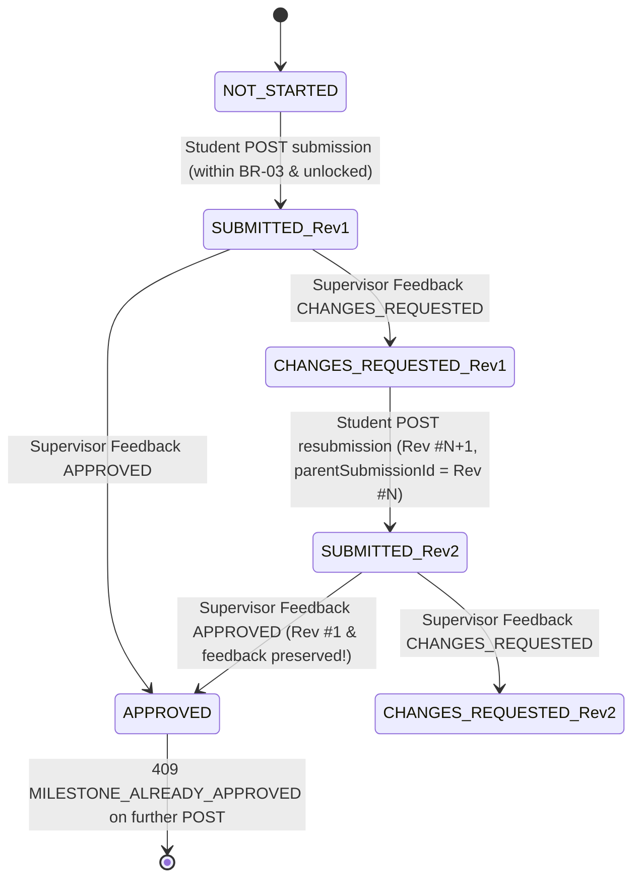

# Sprint 2 Engineering Contracts — Feature `F-03` (`F-03a` & `F-03b`)

- **Project Name:** SprintDUO — Course Project Management System (Theme 6)
- **Team Members:** `67070501084` (`JinggXd`) & `67070501036` (`yuminnini`)
- **Contract Version:** `1.0.0` (Pre-implementation Sprint 2 baseline — authored before Sprint 2 code on top of maintained Sprint 1 `v1.1.0` / `88ac148`)
- **Linked GitHub Issues:** `#7` (`[F-03] (Sprint 2) Submission Revision History & Milestone Editing`), `#33` (`[Lab 6][DEF-SD-03] Submit Milestone Work form shown on PAST DUE milestone`)
- **Resolved Technical Debt from Lab 7 Retro:** `TD-01` (build-time commit SHA in UI footer), `TD-02` (modularized React UI components & ≥ 2 new RTL assertions per feature PR)

---

## 1. Feature Contract `F-03a`: Supervisor Milestone Management, Locking & Status Filtering

- **Linked Requirements:** `FR-05`, `BR-01`, `BR-02`, `BR-03` (`v1.1.0`), `NFR-01`, `NFR-03`
- **Dependencies:** `F-01`, `F-02` (Sprint 1 `v1.1.0`)
- **Owner / Reviewer:** Author: `JinggXd` (`67070501084`) | Reviewer: `yuminnini` (`67070501036`)

### 1.1 Feature SDS & Workflow

### 1.2 Behavior, Rules, Validation, Boundaries, and Permissions

1. **Supervisor Milestone Editing, Deadline Extension & Locking (`PATCH /api/milestones/:milestoneId`):**
   - **Authentication & Role (`NFR-01`, `BR-02`):** Unauthenticated callers receive `401 UNAUTHENTICATED`. Callers with role `STUDENT` receive `403 FORBIDDEN`.
   - **Canonical ID & Existence (`DEF-SD-01`):** Non-canonical or INT4-overflow `:milestoneId` (`parsePositiveIntId`) or non-existent milestone returns `404 NOT_FOUND`.
   - **Supervision Scope (`BR-01`):** Only the assigned team supervisor (`milestone.team.supervisorId === req.user.id`) may edit or lock the milestone. Unassigned supervisors receive `403 FORBIDDEN`.
   - **Partial Update Validation (`400 VALIDATION_ERROR`):** Request body must include at least one updatable field (`title`, `description`, `dueDate`, or `isLocked`).
     - `title` (if provided): string, 3–150 trimmed characters.
     - `description` (if provided): string, 5–2000 trimmed characters.
     - `dueDate` (if provided): valid ISO-8601 date string (`!Number.isNaN(Date.parse(dueDate))`). Extending a past-due milestone's `dueDate` into the future re-opens it under `BR-03`.
     - `isLocked` (if provided): strict boolean (`typeof isLocked === "boolean"`).
     - Empty object `{}` or any invalid field returns `400 VALIDATION_ERROR` with `details` and makes zero DB mutation.
2. **Locked Milestone Submission Guard (`POST /api/milestones/:milestoneId/submissions`):**
   - Checked **after** `401` (`NFR-01`), `403` role (`BR-02`), `404` ID lookup, and `403` team membership (`BR-01`), and **before** `BR-03` deadline/validation checks.
   - If `milestone.isLocked === true`, rejects with HTTP `400` `{ "error": "MILESTONE_LOCKED", "message": "Milestone is locked by supervisor and no longer accepts submissions" }` and stores zero record.
3. **Milestone Status Filtering (`GET /api/teams/:teamId/milestones?status=...`):**
   - Optional query parameter `status` accepts: `ALL` (default when omitted), `NOT_STARTED`, `SUBMITTED`, `CHANGES_REQUESTED`, `APPROVED`, or `LOCKED`.
   - Invalid `status` query value returns `400 VALIDATION_ERROR` (`{ error: "VALIDATION_ERROR", message: "Invalid milestone status filter", details: { status: "..." } }`).
   - Effective status of a milestone is derived from its latest submission (`submissions[0]`, ordered by `revisionNumber DESC, id DESC`):
     - `0` submissions → `NOT_STARTED`
     - Latest submission status → `SUBMITTED` | `CHANGES_REQUESTED` | `APPROVED`
     - `status=LOCKED` filters milestones where `milestone.isLocked === true`.
   - Backward compatibility: Omitting `?status` returns all milestones with identical Sprint 1/Lab 7 JSON structure plus `isLocked` on each milestone and `revisionNumber`/`parentSubmissionId` on each submission.
4. **Closing Lab 6 Minor Defect `#33` (`DEF-SD-03`) & Lab 7 Tech Debt (`TD-01`, `TD-02`):**
   - **UI Form Closure (`#33`):** When a milestone is `PAST DUE` (`now > dueDate + 24h`) or `isLocked === true`, the Student UI hides the "Submit Milestone Work" form and displays an explicit status notice (`"Submissions closed (24-hour grace window expired)"` or `"Milestone is locked by supervisor"`). Server-side `BR-03` and `MILESTONE_LOCKED` remain strictly enforced regardless of UI state.
   - **Build Commit SHA Footer (`TD-01`):** `Dockerfile` and `.github/workflows/deploy.yml` pass `VITE_COMMIT_SHA` and `VITE_APP_VERSION` build arguments so the UI displays the exact deployed version/commit instead of hardcoded `"Release B"`.
   - **UI Modularization (`TD-02`):** Extract dedicated components (`client/src/types.ts`, `client/src/components/MilestoneEditForm.tsx`, `client/src/components/SubmissionHistoryList.tsx`) so `App.tsx` stays maintainable and testable.

### 1.3 API Shapes & Data Layer Changes (`F-03a`)

| Method & Path | Request / Query | Success Response | Error Status & Codes |
| :--- | :--- | :--- | :--- |
| `PATCH /api/milestones/:milestoneId` | `{ title?, description?, dueDate?, isLocked? }` (≥ 1 field) | `200 { milestone: { id, teamId, title, description, dueDate, isLocked, updatedAt } }` | `400` (`VALIDATION_ERROR`), `401`, `403` (`BR-01`/`BR-02`), `404`, `413` |
| `GET /api/teams/:teamId/milestones?status=...` | Optional `status` ∈ `{ALL, NOT_STARTED, SUBMITTED, CHANGES_REQUESTED, APPROVED, LOCKED}` | `200 { team, filter, milestones: [{ ..., isLocked, submissions: [{ ..., revisionNumber, parentSubmissionId, isLate }] }] }` | `400` (`VALIDATION_ERROR`), `401`, `403` (`BR-01`), `404` |

- **Data Layer (`F-03a`):** Additive non-breaking column `Milestone.isLocked BOOLEAN NOT NULL DEFAULT false`. Existing Sprint 1/Lab 5–7 milestones safely default to `isLocked = false`.
- **Unchanged Layers (Explicitly N/A):** `User`, `Session`, `Team`, `TeamMember`, `Feedback` tables and `server/src/routes/auth.ts` / `server/src/middleware/sessionAuth.ts` require **no schema or auth changes** (protected by full Sprint 1 regression suite).

---

## 2. Feature Contract `F-03b`: Student Submission Revision History (`BR-04`)

- **Linked Requirements:** `FR-05`, `BR-01`, `BR-02`, `BR-03` (`v1.1.0`), `BR-04`, `NFR-01`
- **Dependencies:** `F-02`, `F-03a`
- **Owner / Reviewer:** Author: `JinggXd` (`67070501084`) | Reviewer: `yuminnini` (`67070501036`)

### 2.1 Feature SDS & Revision State Machine (`BR-04`)

### 2.2 Behavior, Rules, Validation, Boundaries, and Permissions (`BR-04`)

1. **Ordered Validation & Transition Guards on `POST /api/milestones/:milestoneId/submissions`:**
   1. `401 UNAUTHENTICATED` (`requireAuth`)
   2. `403 FORBIDDEN` (`requireRole("STUDENT")`, `BR-02`)
   3. `404 NOT_FOUND` (`parsePositiveIntId` + milestone existence)
   4. `403 FORBIDDEN` (`BR-01` team membership)
   5. `400 MILESTONE_LOCKED` (if `milestone.isLocked === true`)
   6. `400 DEADLINE_PASSED` (`BR-03 v1.1.0`: `serverNow > dueDate + 24h`)
   7. `400 VALIDATION_ERROR` (`title`, `description`, `artifactUrl` validation — evaluated before status conflict so malformed inputs always fail with `400`)
   8. **Revision Eligibility (`BR-04`):** Inspect the milestone's latest submission (`orderBy: [{ revisionNumber: "desc" }, { id: "desc" }]`):
      - **No prior submission:** Allowed → creates `revisionNumber = 1`, `parentSubmissionId = null`, `status = "SUBMITTED"`, `isLate = deadlineCheck.isLate`.
      - **Latest submission `status === "CHANGES_REQUESTED"`:** Allowed (**Resubmission**) → creates a **new** `Submission` row with `revisionNumber = latest.revisionNumber + 1`, `parentSubmissionId = latest.id`, `status = "SUBMITTED"`, `isLate = deadlineCheck.isLate`. **All prior `Submission` rows and all their `Feedback` records remain completely immutable and preserved in PostgreSQL.**
      - **Latest submission `status === "APPROVED"`:** Rejected with HTTP `409` `{ "error": "MILESTONE_ALREADY_APPROVED", "message": "Milestone already has an approved submission and cannot be resubmitted" }` (zero new record stored).
      - **Latest submission `status === "SUBMITTED"`:** Rejected with HTTP `409` `{ "error": "SUBMISSION_PENDING_REVIEW", "message": "A submission is already awaiting supervisor review before a revision can be submitted" }` (zero new record stored).
2. **Submission Revision History Listing (`GET /api/milestones/:milestoneId/submissions`):**
   - **Access (`NFR-01`, `BR-01`):** Accessible only to registered team `STUDENT` members and the team's assigned `SUPERVISOR`. Unauthenticated → `401`; cross-team student or unassigned supervisor → `403 FORBIDDEN`; invalid/missing milestone → `404 NOT_FOUND`.
   - Returns `{ milestoneId, isLocked, totalRevisions, submissions }` ordered newest-first (`revisionNumber DESC, id DESC`), with every revision's `revisionNumber`, `parentSubmissionId`, `isLate`, `status`, `submittedBy`, and preserved `feedbacks[]`.
3. **Preserved Supervisor Evaluation (`POST /api/submissions/:id/feedback`):**
   - Supervisors can evaluate the newly submitted revision (`Rev #2`) atomically (`prisma.$transaction`) without altering `Rev #1`'s status or feedback records.
4. **UI Behavior (`F-03b`):**
   - `SubmissionHistoryList` renders every submission chronologically (newest first) with a **`Rev #N`** badge (`data-testid="submission-rev-badge-${sub.id}"`), `"Resubmitted from Rev #M"` lineage label when `parentSubmissionId` is present, `LATE` badge when `isLate === true`, and each revision's preserved Supervisor Feedback thread.
   - Student submission form dynamically adapts to milestone state:
     - No prior submission (unlocked, within cutoff) → **"Submit Milestone Work (Rev #1)"**
     - Latest is `CHANGES_REQUESTED` (unlocked, within cutoff) → **"Submit Revision (Rev #N)"** with helper note that prior revisions & feedback are preserved
     - Latest is `SUBMITTED` → blue info banner **"Submission Rev #N is awaiting supervisor review"**
     - Latest is `APPROVED` → green banner **"Milestone Approved (Rev #N) — no further revisions needed"**
     - Locked (`isLocked === true`) → dark banner **"Milestone is locked by supervisor — submissions closed"**
     - Past 24h cutoff (`PAST DUE`) → red banner **"Submissions closed (24-hour grace window expired)"** (closes `#33` `DEF-SD-03`)

### 2.3 API Shapes & Data Layer Changes (`F-03b`)

| Method & Path | Request Body | Success Response | Error Status & Codes |
| :--- | :--- | :--- | :--- |
| `POST /api/milestones/:milestoneId/submissions` | `{ title, description, artifactUrl }` | `201 { submission: { id, milestoneId, revisionNumber, parentSubmissionId, status: "SUBMITTED", isLate, ... } }` | `400` (`MILESTONE_LOCKED` / `DEADLINE_PASSED` / `VALIDATION_ERROR`), `401`, `403`, `404`, `409` (`MILESTONE_ALREADY_APPROVED` / `SUBMISSION_PENDING_REVIEW`), `413` |
| `GET /api/milestones/:milestoneId/submissions` | None | `200 { milestoneId, isLocked, totalRevisions, submissions: [...] }` | `401`, `403` (`BR-01`), `404` |
| `GET /api/submissions/:id` | None | `200 { submission: { ..., revisionNumber, parentSubmissionId, isLate, milestone: { ..., isLocked }, feedbacks } }` | `401`, `403` (`BR-01`), `404` |

- **Additive Non-Breaking Prisma Migration (`20261126160000_sprint2_milestone_lock_and_revisions`):**
  1. `ALTER TABLE "Milestone" ADD COLUMN "isLocked" BOOLEAN NOT NULL DEFAULT false;`
  2. `ALTER TABLE "Submission" ADD COLUMN "revisionNumber" INTEGER NOT NULL DEFAULT 1;`
  3. `ALTER TABLE "Submission" ADD COLUMN "parentSubmissionId" INTEGER;`
  4. Safe deterministic backfill for any historical milestones that already received multiple submissions during Labs 5–7 (`ROW_NUMBER() OVER (PARTITION BY "milestoneId" ORDER BY "submittedAt" ASC, id ASC)`), without deleting or mutating any existing submission titles, URLs, statuses, or feedbacks.
  5. Foreign key `Submission.parentSubmissionId -> Submission.id ON DELETE SET NULL` and index `CREATE INDEX "Submission_milestoneId_revisionNumber_idx" ON "Submission"("milestoneId", "revisionNumber");`.

---

## 3. Sprint 2 Acceptance Criteria (`AC-07` to `AC-11`)

| AC ID | Feature | Acceptance Criterion (Observable Outcome) |
| :--- | :---: | :--- |
| **AC-07** | `F-03a` | **Supervisor Milestone Edit & Deadline Extension (`FR-05`):** An assigned `SUPERVISOR` updates a milestone's `title`, `description`, and/or `dueDate` via `PATCH /api/milestones/:id` (`200`); changes persist across reload, and extending a past-due milestone's `dueDate` into the future re-enables student submissions. Invalid payloads return `400 VALIDATION_ERROR`. |
| **AC-08** | `F-03a` | **Supervisor Milestone Locking & Guard (`FR-05`, `#33`):** An assigned `SUPERVISOR` toggles `isLocked` (`true`/`false`) via `PATCH /api/milestones/:id` (`200`). While `isLocked === true`, student submission attempts are rejected server-side with `400 MILESTONE_LOCKED` (zero record stored), and the Student UI hides the submission form on both locked and `PAST DUE` milestones (resolving Lab 6 `#33`). |
| **AC-09** | `F-03a` | **Milestone Status Filtering (`FR-05`):** `GET /api/teams/:teamId/milestones?status=...` accurately filters milestones by `NOT_STARTED`, `SUBMITTED`, `CHANGES_REQUESTED`, `APPROVED`, `LOCKED`, or `ALL`, returns `400 VALIDATION_ERROR` on invalid filter values, and renders matching results in the UI filter bar. |
| **AC-10** | `F-03b` | **Revision History Preservation (`FR-05`, `BR-04`):** After a supervisor records `CHANGES_REQUESTED` on `Rev #1`, a team `STUDENT` can submit `Rev #2` (`201`, `revisionNumber: 2`, `parentSubmissionId: rev1.id`) inside the unlocked deadline/grace window. Both `GET /api/milestones/:id/submissions` (`200`) and the UI preserve `Rev #1` and its original supervisor feedback intact alongside `Rev #2` and its subsequent evaluation. Attempting to submit while `SUBMITTED` (`409 SUBMISSION_PENDING_REVIEW`) or after `APPROVED` (`409 MILESTONE_ALREADY_APPROVED`) is rejected with zero new row stored. |
| **AC-11** | `F-03a`, `F-03b` | **Sprint 2 Access Control & Regression Integrity (`BR-01`, `BR-02`, `NFR-01`):** Unauthenticated calls to `PATCH /api/milestones/:id` or `GET /api/milestones/:id/submissions` return `401`. Students or unassigned supervisors calling `PATCH /api/milestones/:id`, and foreign-team users calling `GET /api/milestones/:id/submissions`, return `403 FORBIDDEN`. All Sprint 1 & Lab 5–7 regression suites remain green. |

---

## 4. Contract Revision History

| Version | Date | Author(s) | Summary of Change |
| :--- | :--- | :--- | :--- |
| `1.0.0` | 2026-11-26 | `JinggXd` (for review by `yuminnini`) | Initial pre-implementation Sprint 2 contracts (`F-03a`, `F-03b`), `AC-07`–`AC-11`, additive migration design, `#33` defect closure, and Lab 7 `TD-01`/`TD-02` remediation. |
