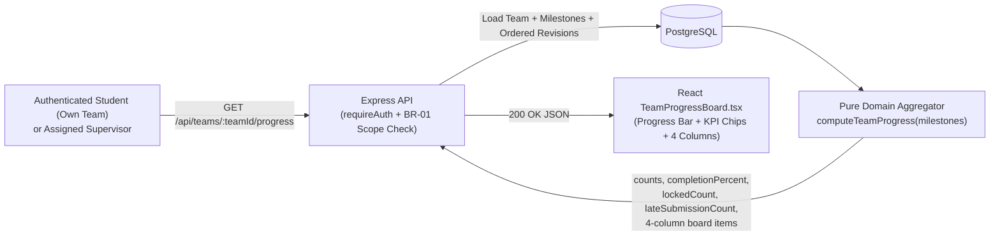

# Sprint 3 Engineering Contracts — Feature `F-04` (`F-04a` & `F-04b`)

- **Project Name:** SprintDUO — Course Project Management System (Theme 6)
- **Team Members:** `67070501084` (`JinggXd`) & `67070501036` (`yuminnini`)
- **Contract Version:** `1.0.0` (Pre-implementation Sprint 3 baseline — authored before Sprint 3 code on top of completed Sprint 2 `v2.0.0` / `3e0beb0`)
- **Linked GitHub Issue:** `#8` (`[F-04] (Sprint 3) Team Progress Board & Supervisor Summary Report`)
- **Deliverable 2 Checkpoint Scope vs. Final Delivery Scope:**
  - **`F-04a` (Team Milestone Progress Board):** Implemented, unit/API/DB/UI tested, and deployed in the Deliverable 2 Integrated Release Candidate (**`v2.1.0-rc1`**, due 29 Nov 2026).
  - **`F-04b` (Supervisor Course-Wide Summary Report):** Fully specified in contract, AC, and STS here; explicitly marked **`PLANNED`** for Final Delivery (**`v3.0.0`**, due 13 Dec 2026, scheduled around the 1–11 Dec final examination period).

---

## 1. Feature Contract `F-04a`: Team Milestone Progress Board *(Implemented & Tested in Deliverable 2 `v2.1.0-rc1`)*

- **Linked Requirements:** `FR-06`, `BR-01`, `BR-03` (`v1.1.0`), `BR-04`, `NFR-01`
- **Dependencies:** `F-01`, `F-02`, `F-03a`, `F-03b`
- **Owner / Reviewer:** Author: `JinggXd` (`67070501084`) | Reviewer: `yuminnini` (`67070501036`)

### 1.1 Feature SDS & Domain Aggregation Flow

### 1.2 Behavior, Rules, Boundaries, and Permissions

1. **Authentication & Team Scope (`NFR-01`, `BR-01`):**
   - Unauthenticated requests to `GET /api/teams/:teamId/progress` return `401 UNAUTHENTICATED`.
   - Non-canonical or INT4-overflow `:teamId` (`parsePositiveIntId`, preserving `DEF-SD-01`) or non-existent team returns `404 NOT_FOUND`.
   - Only registered members of `:teamId` (`STUDENT`) or the assigned `SUPERVISOR` (`team.supervisorId === req.user.id`) may view the progress board. Foreign-team students and unassigned supervisors receive `403 FORBIDDEN`.
2. **Deterministic Progress Aggregation Rules (`computeTeamProgress`):**
   - For each milestone belonging to `:teamId` (ordered by `dueDate ASC, id ASC`), inspect its latest submission (`orderBy: [{ revisionNumber: "desc" }, { id: "desc" }]`):
     - `0` submissions → effective milestone status = `NOT_STARTED` (`latestRevisionNumber: 0`, `isLate: false`)
     - `>= 1` submissions → effective milestone status = `latest.status` (`SUBMITTED` | `CHANGES_REQUESTED` | `APPROVED`), `latestRevisionNumber = latest.revisionNumber ?? 1`, `isLate = Boolean(latest.isLate)`.
   - Aggregate counts:
     - `totalMilestones = milestones.length`
     - `counts = { NOT_STARTED, SUBMITTED, CHANGES_REQUESTED, APPROVED }` (sum strictly equals `totalMilestones`)
     - `lockedCount` = count of milestones where `isLocked === true`
     - `totalSubmissions` = total submission rows across all revisions of all milestones for `:teamId`
     - `lateSubmissionCount` = count of submissions across all revisions where `isLate === true`
     - `completionPercent` = `totalMilestones === 0 ? 0 : Math.round((counts.APPROVED / totalMilestones) * 100)` (bounded `0..100`, safe against division by zero).
   - Group compact board items into `columns: { NOT_STARTED: [], SUBMITTED: [], CHANGES_REQUESTED: [], APPROVED: [] }`.
3. **UI Behavior (`client/src/components/TeamProgressBoard.tsx`):**
   - Renders inside the authenticated dashboard for the selected team with:
     - Completion progress bar (`data-testid="progress-completion-bar"`) showing `X% Approved (A / N milestones)`
     - Summary KPI chips (`Not Started`, `Submitted`, `Changes Requested`, `Approved`, `Locked`, `Late Submissions`)
     - 4-column visual status board (`Not Started`, `Submitted`, `Changes Requested`, `Approved`) listing each milestone card's title, due date, revision badge (`Rev #N`), `LOCKED` / `LATE` flags, and an empty-column placeholder when `0` items exist in a column.
   - Refreshes automatically whenever a milestone is created, edited/locked, submitted/resubmitted, or evaluated with feedback, and clears cleanly on `Log Out` (`DEF-SD-05`).

### 1.3 API & Data Shapes (`F-04a`)

| Method & Path | Request / Query | Success Response Shape | Error Status & Codes |
| :--- | :--- | :--- | :--- |
| `GET /api/teams/:teamId/progress` | None | `200 { team: { id, code, name, projectTitle }, summary: { totalMilestones, totalSubmissions, lockedCount, lateSubmissionCount, completionPercent, counts: { NOT_STARTED, SUBMITTED, CHANGES_REQUESTED, APPROVED } }, columns: { NOT_STARTED: [...], SUBMITTED: [...], CHANGES_REQUESTED: [...], APPROVED: [...] } }` | `401` (`UNAUTHENTICATED`), `403` (`FORBIDDEN`, `BR-01`), `404` (`NOT_FOUND`) |

- **Data Layer (`F-04a`):** **N/A — no database schema migration required.** Reads exclusively from existing `Team`, `TeamMember`, `Milestone`, and `Submission` tables created in Sprint 1, Lab 7 (`isLate`), and Sprint 2 (`isLocked`, `revisionNumber`).
- **Auth Layer:** **N/A — no changes to `auth.ts` or `sessionAuth.ts`.**

---

## 2. Feature Contract `F-04b`: Supervisor Course-Wide Summary Report *(Specified in Deliverable 2; Planned Implementation for Final Delivery `v3.0.0` by 13 Dec)*

- **Linked Requirements:** `FR-06`, `BR-01`, `BR-02`, `NFR-01`
- **Dependencies:** `F-04a`
- **Owner / Reviewer:** Planned Implementation: `yuminnini` (`67070501036`) & `JinggXd` (`67070501084`) | Target Release: `v3.0.0` (12–13 Dec 2026)

### 2.1 Behavior, Rules, Validation, and Permissions (`F-04b`)

1. **Role & Supervision Scope (`NFR-01`, `BR-01`, `BR-02`):**
   - Endpoint: `GET /api/supervisor/summary`
   - Unauthenticated requests return `401 UNAUTHENTICATED`.
   - `STUDENT` callers are rejected server-side with `403 FORBIDDEN` (`BR-02` role separation).
   - Authenticated `SUPERVISOR` receives summary metrics aggregated **strictly** across teams where `team.supervisorId === req.user.id` (`BR-01`); zero data from other supervisors' teams is ever included.
2. **Aggregated Summary Calculation:**
   - Reuses `computeTeamProgress(milestones)` per supervised team to produce:
     - `overall`: `{ supervisedTeamCount, totalMilestones, approvedMilestones, pendingReviewCount, changesRequestedCount, notStartedCount, lateSubmissionCount, overallCompletionPercent }`
     - `teams`: array of per-team rows `{ teamId, code, name, projectTitle, memberCount, totalMilestones, approvedCount, submittedCount, changesRequestedCount, notStartedCount, lockedCount, lateSubmissionCount, completionPercent }`, sorted by `code ASC`.
3. **UI Behavior (`SupervisorSummaryReport.tsx` — Planned for `v3.0.0`):**
   - Visible only when `currentUser.role === "SUPERVISOR"` (via tab/toggle `"Course Summary Report"`).
   - Displays course-wide KPI summary cards, a sortable/readable multi-team summary table, and a client-side CSV download button exporting synthetic team summary counts (zero credentials/PII beyond team names/counts).

### 2.2 API & Data Shapes (`F-04b`)

| Method & Path | Request / Query | Success Response Shape | Error Status & Codes |
| :--- | :--- | :--- | :--- |
| `GET /api/supervisor/summary` | None | `200 { supervisor: { id, name, email }, overall: { supervisedTeamCount, totalMilestones, approvedMilestones, pendingReviewCount, changesRequestedCount, notStartedCount, lateSubmissionCount, overallCompletionPercent }, teams: [{ teamId, code, name, projectTitle, memberCount, totalMilestones, approvedCount, submittedCount, changesRequestedCount, notStartedCount, lockedCount, lateSubmissionCount, completionPercent }] }` | `401` (`UNAUTHENTICATED`), `403` (`FORBIDDEN`, `BR-02` student blocked) |

- **Data Layer (`F-04b`):** **N/A — no database schema migration required.**

---

## 3. Sprint 3 Acceptance Criteria (`AC-12` to `AC-15`)

| AC ID | Feature | Checkpoint Status Target | Acceptance Criterion (Observable Outcome) |
| :--- | :---: | :---: | :--- |
| **AC-12** | `F-04a` | **Deliverable 2 (`v2.1.0-rc1`)** | **Team Progress Board Aggregation & UI (`FR-06`):** Calling `GET /api/teams/:teamId/progress` as a team `STUDENT` or assigned `SUPERVISOR` returns `200` with exact milestone status counts (`NOT_STARTED`, `SUBMITTED`, `CHANGES_REQUESTED`, `APPROVED`), `lockedCount`, `lateSubmissionCount`, `completionPercent` (`0` when empty), and 4 grouped columns reflecting the latest revision (`BR-04`). Client UI renders the completion bar, KPI counts, and 4 columns and updates after submissions/feedback. |
| **AC-13** | `F-04a` | **Deliverable 2 (`v2.1.0-rc1`)** | **Progress Board Access & Overflow Protection (`BR-01`, `NFR-01`):** Unauthenticated calls to `GET /api/teams/:teamId/progress` return `401`. Foreign-team `STUDENT` and unassigned `SUPERVISOR` callers receive `403 FORBIDDEN`. Overflow/non-canonical IDs (`2147483648`, `1e0`) return `404 NOT_FOUND`. |
| **AC-14** | `F-04b` | **Planned (Final Delivery `v3.0.0`, 13 Dec)** | **Supervisor Course-Wide Summary Aggregation (`FR-06`, `BR-01`):** Calling `GET /api/supervisor/summary` as an authenticated `SUPERVISOR` returns `200` with accurate overall and per-team progress counts strictly scoped to teams where `team.supervisorId === req.user.id`, rendered in the Supervisor Summary table with CSV export. |
| **AC-15** | `F-04b` | **Planned (Final Delivery `v3.0.0`, 13 Dec)** | **Supervisor Summary Role Isolation (`BR-02`, `NFR-01`):** Unauthenticated calls to `GET /api/supervisor/summary` return `401`, and `STUDENT` callers are rejected server-side with `403 FORBIDDEN`. |

---

## 4. Contract Revision History

| Version | Date | Author(s) | Summary of Change |
| :--- | :--- | :--- | :--- |
| `1.0.0` | 2026-11-26 | `JinggXd` (for review by `yuminnini`) | Initial pre-implementation Sprint 3 contracts covering all remaining baseline features (`F-04a` Team Progress Board & `F-04b` Supervisor Course Summary Report), `AC-12`–`AC-15`, and explicit Deliverable 2 vs. Final Delivery boundary. |
