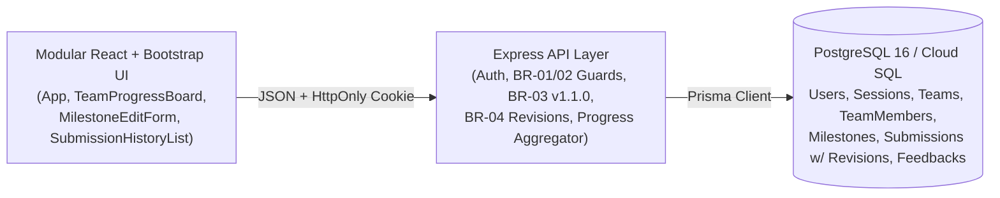
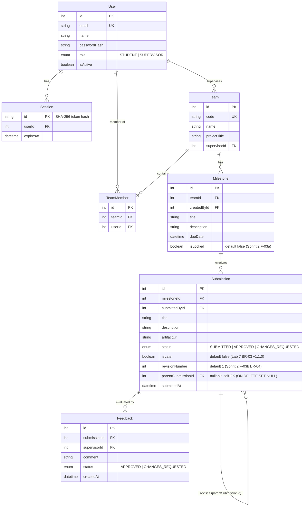

# Part C: System-Level Software Design Specification (System-Level SDS)

- **Project Name:** SprintDUO — Course Project Management System (Theme 6)
- **Team Members:** `67070501084` (`JinggXd`) & `67070501036` (`yuminnini`)
- **Version:** `2.1.0-rc1` (Deliverable 2 Integrated Release Candidate — Updated 27 Nov 2026)

---

## 1. Architecture and Data Model

### 1.1 Stack and Component Responsibilities
- **UI Layer (`client/src/`):** React 18 + TypeScript + Vite + Bootstrap 5, modularized in Sprint 2–3 (`TD-02`) into:
  - `App.tsx`: Auth/session lifecycle, team selector, status filter bar, Create Milestone form, adaptive Student Submit/Resubmit form (`#33` closed-state notices), and build version/commit footer (`TD-01`: `VITE_APP_VERSION` & `VITE_COMMIT_SHA`).
  - `components/MilestoneEditForm.tsx`: Supervisor inline Edit/Extend/Lock milestone panel (`F-03a`).
  - `components/SubmissionHistoryList.tsx`: Chronological revision cards (`Rev #N`, parent lineage, `LATE` badge, preserved feedback threads, supervisor evaluation form — `F-03b`).
  - `components/TeamProgressBoard.tsx`: Visual 4-column Progress Board with completion bar and KPI chips (`F-04a`).
  - `types.ts`: Shared frontend domain types.
- **API / Application Layer (`server/src/`):** Express 4 + TypeScript (`64 KB` JSON limit `413`, strict canonical INT4 ID validation `404`):
  - `middleware/sessionAuth.ts`: SHA-256 session cookie hydration (`requireAuth` `401`, `requireRole` `403`).
  - `routes/auth.ts`: Login, `/me`, Logout (`F-01`).
  - `routes/supervisor.ts`: Scoped teams, filterable milestones (`?status=...`), milestone creation, milestone edit/lock (`PATCH /api/milestones/:id`), atomic feedback transaction, and Team Progress Board (`GET /api/teams/:teamId/progress`).
  - `routes/student.ts`: Student submission & `BR-04` resubmission lifecycle (`400 MILESTONE_LOCKED`, `400 DEADLINE_PASSED`, `409` conflict guards), revision history (`GET /api/milestones/:id/submissions`), and persisted submission detail (`GET /api/submissions/:id`).
  - `utils/validation.ts` & `utils/progress.ts`: Pure unit-testable validators (`BR-03 v1.1.0`, partial milestone edits, status filters) and deterministic progress aggregation (`computeTeamProgress`).
- **Database Layer (`server/prisma/`):** PostgreSQL 16 + Prisma ORM with additive non-breaking migrations (`20261106113412_init`, `20261125150000_add_submission_is_late`, `20261126160000_sprint2_milestone_lock_and_revisions`).

### 1.2 Data Model (ERD), Constraints, and Ownership Links

- **Key Constraints & Ownership Links:**
  - **Supervision Ownership (`BR-01`):** `Team.supervisorId -> User.id`.
  - **Student Team Membership (`BR-01`):** `TeamMember` enforces `@@unique([teamId, userId])`.
  - **Revision Lineage (`BR-04`):** `Submission.parentSubmissionId -> Submission.id` (`ON DELETE SET NULL`) + composite index `(milestoneId, revisionNumber)` preserve every historical revision and its associated `Feedback` rows without overwriting prior work.

### 1.3 Migrations and Reproducible Seed Data
- Schema migrations run locally via `npx prisma migrate dev` and in CI/Cloud Run via `npx prisma migrate deploy` (`sprintduo-migrate` job):
  1. `20261106113412_init`: Initial Sprint 1 tables (`User`, `Session`, `Team`, `TeamMember`, `Milestone`, `Submission`, `Feedback`).
  2. `20261125150000_add_submission_is_late` (Lab 7 `v1.1.0`): Additive `Submission.isLate BOOLEAN NOT NULL DEFAULT false`.
  3. `20261126160000_sprint2_milestone_lock_and_revisions` (Sprint 2 `v2.0.0`): Additive `Milestone.isLocked BOOLEAN NOT NULL DEFAULT false`, `Submission.revisionNumber INTEGER NOT NULL DEFAULT 1`, `Submission.parentSubmissionId INTEGER` (self-FK), plus safe deterministic `ROW_NUMBER()` backfill for existing multi-submission milestones.
  4. **Sprint 3 (`F-04a` & `F-04b`):** Zero schema migrations required (aggregates live data directly from existing tables).
- `server/prisma/seed.ts` seeds synthetic `@sprintduo.edu` teams (`TEAM-ALPHA`, `TEAM-BETA`), supervisors, students, and sample open/past-due milestones (configured via environment variables; zero real passwords in Git).

---

## 2. UI, API, and Access Conventions

### 2.1 Screens and Shared UI States
1. **Login View:** Email/password form, error banner (`role="alert"`), and live build version/commit banner (`TD-01`).
2. **Main Dashboard:** Team selector & details, **Team Progress Board (`F-04a`)** with completion bar & 4 status columns, Supervisor **"Create Milestone"** form, **Status Filter bar** (`All`, `Not Started`, `Submitted`, `Changes Requested`, `Approved`, `Locked`), Milestone cards with `OPEN`/`GRACE PERIOD (24H)`/`PAST DUE`/`LOCKED` badges, Supervisor inline **"Edit / Lock"** panel (`F-03a`), Student adaptive **"Submit Work / Submit Revision (Rev #N)"** form or explicit closed/locked/approved notices (`#33`), and chronological **Submission Revision History** (`Rev #N` + `LATE` + Feedbacks — `F-03b`).
3. **Transient State Isolation (`DEF-SD-02`, `DEF-SD-05`):** `Log Out` and `Sign In` reset all alerts, filter state, editing state, unsent form drafts, and progress board data cleanly.

### 2.2 API Conventions
- JSON request/response under `/api/*` (`64 KB` body limit → `413 PAYLOAD_TOO_LARGE`; malformed JSON → `400 VALIDATION_ERROR`).
- Standard error shape: `{ "error": "CODE", "message": "Human-readable message", "details"?: { ... } }`.
- Status codes: `200 OK`, `201 Created`, `204 No Content`, `400 Bad Request` (`VALIDATION_ERROR`, `DEADLINE_PASSED`, `MILESTONE_LOCKED`), `401 Unauthorized`, `403 Forbidden`, `404 Not Found` (incl. INT4 overflow/non-canonical IDs), `409 Conflict` (`SUBMISSION_PENDING_REVIEW`, `MILESTONE_ALREADY_APPROVED`), `413 Payload Too Large`.

### 2.3 Role and Permission Matrix
All permissions are enforced server-side in Express middleware and route handlers; hiding UI controls is never relied upon for security.

| Protected Operation | Feature | Unauthenticated | `STUDENT` (Own Team) | `STUDENT` (Other Team) | `SUPERVISOR` (Assigned Team) | `SUPERVISOR` (Other Team) |
| :--- | :---: | :---: | :---: | :---: | :---: | :---: |
| `GET /api/teams` | `F-02` | `401` | **Allow (Own team)** | Excluded | **Allow (Supervised)** | Excluded |
| `GET /api/teams/:teamId/milestones[?status=...]` | `F-02`/`F-03a` | `401` | **Allow (`200`)** | **Deny (`403`)** | **Allow (`200`)** | **Deny (`403`)** |
| `POST /api/teams/:teamId/milestones` | `F-01` | `401` | **Deny (`403`)** | **Deny (`403`)** | **Allow (`201`)** | **Deny (`403`)** |
| `PATCH /api/milestones/:milestoneId` | `F-03a` | `401` | **Deny (`403`)** | **Deny (`403`)** | **Allow (`200`)** | **Deny (`403`)** |
| `POST /api/milestones/:id/submissions` | `F-02`/`F-03b` | `401` | **Allow (`201`/`400`/`409`)** | **Deny (`403`)** | **Deny (`403`)** | **Deny (`403`)** |
| `GET /api/milestones/:id/submissions` | `F-03b` | `401` | **Allow (`200`)** | **Deny (`403`)** | **Allow (`200`)** | **Deny (`403`)** |
| `GET /api/submissions/:id` | `F-02` | `401` | **Allow (`200`)** | **Deny (`403`)** | **Allow (`200`)** | **Deny (`403`)** |
| `POST /api/submissions/:id/feedback` | `F-01` | `401` | **Deny (`403`)** | **Deny (`403`)** | **Allow (`201`)** | **Deny (`403`)** |
| `GET /api/teams/:teamId/progress` | `F-04a` | `401` | **Allow (`200`)** | **Deny (`403`)** | **Allow (`200`)** | **Deny (`403`)** |
| `GET /api/supervisor/summary` *(Planned `v3.0.0`)* | `F-04b` | `401` | **Deny (`403`)** | **Deny (`403`)** | **Allow (`200`, own teams)** | Excluded |

### 2.4 Credential and Session Handling
- **Password Hashing:** Argon2id (`memoryCost: 19456 KiB`, `timeCost: 2`).
- **Session Creation & Expiry:** 32-byte random token, SHA-256 hash stored in `Session` (8-hour expiry), sent via `Set-Cookie: sprintduo_session=<token>; HttpOnly; SameSite=Lax; Path=/` (`Secure` in production HTTPS).
- **Logout:** Deletes PostgreSQL `Session` row and clears cookie (`204 No Content`).

---

## 3. Configuration and GCP Deployment Design (`NFR-03`)
- Configured via environment variables (`DATABASE_URL`, `DATABASE_URL_TEST`, `PORT`, `CLIENT_ORIGIN`, build args `VITE_COMMIT_SHA`, `VITE_APP_VERSION`); `.env` is gitignored.
- **Production GCP Stack:** Multi-stage unified `Dockerfile` → Artifact Registry (`asia-southeast1-docker.pkg.dev/cpe334-team23/sprintduo/sprintduo:<40-char-sha>`) → Cloud Run Job `sprintduo-migrate` (`prisma migrate deploy` on Cloud SQL PostgreSQL `sprintduo-pg`) → Cloud Run service `sprintduo` (`https://sprintduo-hbiakb2znq-as.a.run.app`) → automated `deploy/smoke_test.py`. Authentication uses keyless GitHub OIDC Workload Identity Federation (WIF) and Secret Manager (`DATABASE_URL`).

---

## 4. Revision History

| Version | Date | Author(s) | Summary of Change |
| :--- | :--- | :--- | :--- |
| `1.0.0` | 2026-11-04 | `JinggXd`, `yuminnini` | Initial System-Level SDS baseline for Sprint 1 (`v1.0.0`). |
| `1.1.0` | 2026-11-25 | `JinggXd` (reviewed by `yuminnini`) | Lab 7 Issue `#36`: Added `Submission.isLate` (`BOOLEAN NOT NULL DEFAULT false`) and 24-hour grace UI states. |
| `2.1.0-rc1` | 2026-11-27 | `JinggXd` (reviewed by `yuminnini`) | Deliverable 2 update: added Sprint 2 ERD fields (`Milestone.isLocked`, `Submission.revisionNumber`, `Submission.parentSubmissionId`), additive migration `20261126160000_sprint2_milestone_lock_and_revisions`, modular frontend components (`MilestoneEditForm`, `SubmissionHistoryList`, `TeamProgressBoard`), `VITE_COMMIT_SHA` build args, and updated Permission Matrix (`F-03a`, `F-03b`, `F-04a`, planned `F-04b`). |
