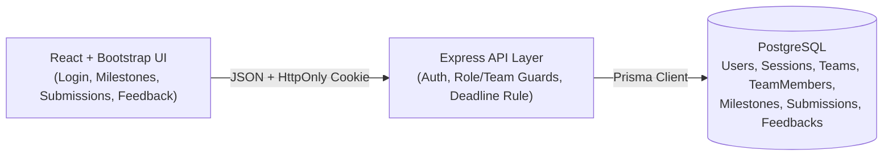
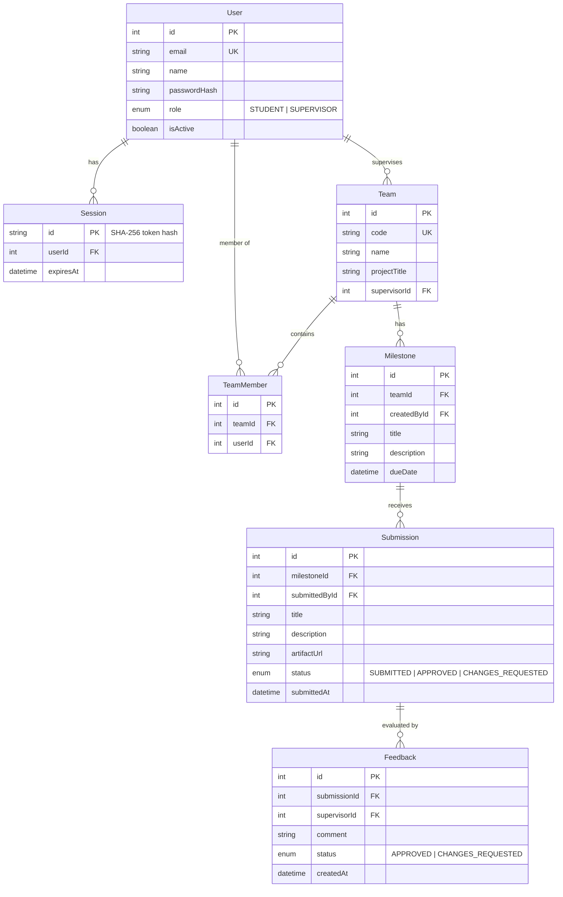

# Part C: System-Level Software Design Specification (System-Level SDS)

- **Project Name:** SprintDUO — Course Project Management System (Theme 6)
- **Team Members:** `67070501084` (`JinggXd`) & `67070501036` (`yuminnini`)

---

## 1. Architecture and Data Model

### 1.1 Stack and Component Responsibilities
- **UI Layer (`client/`):** React 18 + TypeScript + Vite + Bootstrap 5. Renders Login screen, Team & Milestone dashboard, Student Submission form, and Supervisor Feedback form.
- **API / Application Layer (`server/`):** Express 4 + TypeScript. Enforces session authentication (`requireAuth`), role checks (`requireRole`), team membership/supervision scope (`BR-01`, `BR-02`), and server-side deadline & URL validation (`BR-03`).
- **Database Layer (`server/prisma/`):** PostgreSQL + Prisma ORM. Enforces relational integrity and executes atomic transactions (`prisma.$transaction`) when recording feedback and updating submission status.

### 1.2 Data Model (ERD), Constraints, and Ownership Links

- **Key Constraints & Ownership Links:**
  - **Supervision Ownership:** `Team.supervisorId -> User.id` defines which `SUPERVISOR` owns a team (`BR-01`).
  - **Student Team Membership:** `TeamMember` enforces `@@unique([teamId, userId])` and links `STUDENT` users to their team (`BR-01`).
  - **Submission & Feedback Association:** `Submission.milestoneId -> Milestone.id` and `Feedback.submissionId -> Submission.id` preserve the audit chain from team milestone to student submission and supervisor evaluation.

### 1.3 Migrations and Reproducible Seed Data
- Schema migrations run via `npx prisma migrate dev`.
- `server/prisma/seed.ts` seeds synthetic demo data (using a local synthetic demo password configured in `seed.ts`; no real/production secrets are stored in Git):
  - **Supervisors:** `sup.advisor1@sprintduo.edu` (supervises **Team Alpha**) and `sup.advisor2@sprintduo.edu` (supervises **Team Beta**).
  - **Students:** `stu.jing@sprintduo.edu` and `stu.yumi@sprintduo.edu` (members of **Team Alpha**); `stu.other@sprintduo.edu` and `stu.other2@sprintduo.edu` (members of **Team Beta**, for testing cross-team `403` isolation).
  - **Milestones on Team Alpha:** 1 active milestone (due in +7 days) and 1 past-due milestone (due -2 days ago, for testing deadline rejection `BR-03`).

---

## 2. UI, API, and Access Conventions

### 2.1 Screens and Shared UI States
1. **Login View:** Email/password form with validation/error alert (`role="alert"`).
2. **Main Team & Milestone View:** Shows the user's team(s), milestone cards, **"Create Milestone"** form (for `SUPERVISOR`), **"Submit Work"** form (for `STUDENT`), and persisted **Submission & Feedback** details.
3. **UI States:** Loading spinner (`Loading...`), empty state when no milestones/submissions exist, validation/rejection alert banner (`role="alert"`), and success confirmation alert.

### 2.2 API Conventions
- JSON request/response under `/api/*`.
- Standard error shape: `{ "error": "CODE", "message": "Human-readable message", "details": { ... } }`.
- Status codes: `200 OK`, `201 Created`, `204 No Content`, `400 Bad Request` (validation or past deadline), `401 Unauthorized` (not logged in), `403 Forbidden` (wrong role or foreign team), `404 Not Found`.

### 2.3 Role and Permission Matrix
All permissions are enforced server-side in Express middleware and route handlers; hiding a frontend button is never relied upon for authorization.

| Protected Operation | Unauthenticated | `STUDENT` (Own Team) | `STUDENT` (Other Team) | `SUPERVISOR` (Assigned Team) | `SUPERVISOR` (Other Team) |
| :--- | :---: | :---: | :---: | :---: | :---: |
| `GET /api/teams` | `401` | **Allow (Own team)** | Excluded | **Allow (Supervised team)** | Excluded |
| `GET /api/teams/:teamId/milestones` | `401` | **Allow (`200`)** | **Deny (`403`)** | **Allow (`200`)** | **Deny (`403`)** |
| `POST /api/teams/:teamId/milestones` | `401` | **Deny (`403`)** | **Deny (`403`)** | **Allow (`201`)** | **Deny (`403`)** |
| `POST /api/milestones/:id/submissions` | `401` | **Allow (`201`/`400`)** | **Deny (`403`)** | **Deny (`403`)** | **Deny (`403`)** |
| `GET /api/submissions/:id` | `401` | **Allow (`200`)** | **Deny (`403`)** | **Allow (`200`)** | **Deny (`403`)** |
| `POST /api/submissions/:id/feedback` | `401` | **Deny (`403`)** | **Deny (`403`)** | **Allow (`201`)** | **Deny (`403`)** |

### 2.4 Credential and Session Handling
- **Password Hashing:** Passwords are hashed locally with **Argon2id** (`memoryCost: 19456 KiB`, `timeCost: 2`).
- **Session Creation & Expiry:** `POST /api/auth/login` generates a 32-byte random token, stores its **SHA-256 hash** in `Session` with an 8-hour `expiresAt` timestamp, and sets `Set-Cookie: sprintduo_session=<token>; HttpOnly; SameSite=Lax; Path=/`.
- **Current-User Retrieval:** `GET /api/auth/me` hashes the incoming cookie token, verifies the `Session` row exists and has not expired (`now < expiresAt`), and returns `{ user: { id, name, email, role } }` (or `401` if missing/expired).
- **Logout Behavior:** `POST /api/auth/logout` deletes the `Session` row in PostgreSQL and clears the cookie (`204 No Content`).

---

## 3. Configuration and GCP Deployment Design (Lab 5)
- Configured via environment variables (`DATABASE_URL`, `DATABASE_URL_TEST`, `PORT`, `CLIENT_ORIGIN`); `.env` is gitignored so real secrets never enter Git or client bundles.
- **Planned GCP Setup (Lab 5):** Stateless Docker container deployed to **Google Cloud Run**, connected to **Cloud SQL for PostgreSQL** for durable storage, with secrets injected via **Google Secret Manager**.
